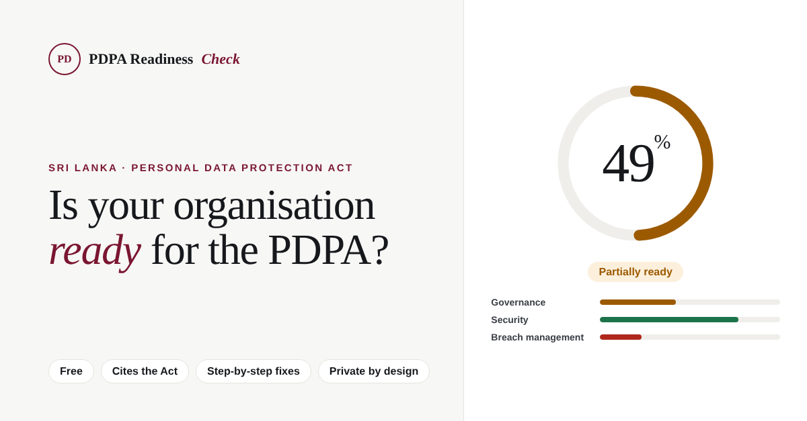

# PDPA Readiness Check

A free self-assessment for Sri Lankan organisations preparing for the **Personal Data Protection Act, No. 9 of 2022**, as amended by **Act No. 22 of 2025**. Core obligations (Parts I and III) come into force on **1 January 2027**.

**Live site:** https://pdpa-readiness-check.vercel.app



## Features
- **105 questions**, each citing the section of the Act it tests, with guidance, evidence prompts and step-by-step fixes
- **Profile-based scoping**: private sector, public authority or NGO, plus 13 yes/no questions (CCTV, marketing, overseas transfers, DPO and more) that switch off what doesn't apply
- **Quick check** (~10 minutes, core obligations) or **full audit**
- **Weighted scoring**: a headline score for obligations in force from 1 January 2027; Parts II (data subject rights) and IV (direct marketing) scored separately
- **30/60/90-day roadmap**, ranked by legal weight and effort
- **Printable report** with executive summary, critical findings, roadmap and sign-off, plus **Markdown** and **CSV** exports
- **Responsive**: phones, tablets and desktops
- **Private by design**: no backend, no accounts, no analytics; answers stay in the user's browser

## Scoring
Yes = 1, Partly = 0.5, No and Not sure = 0; N/A is excluded. Items are weighted 3 (critical), 2 (important) or 1 (good practice). Bands: 85%+ Ready, 60–84% Nearly ready, 35–59% Partially ready, below 35% Not ready.

## Run locally
No build step. Serve the folder with any static server, for example:

```bash
python3 -m http.server 8000
# then open http://localhost:8000
```

## Deploy
Deployed on Vercel as a static site (no framework, no build command). `vercel.json` sets clean URLs and security headers.

## Project structure
| File | Purpose |
|---|---|
| `index.html` | Interface, scoring and report logic |
| `data.js` | Question bank: sections, weights, guidance, evidence, actions, remediation steps |
| `privacy.html`, `terms.html`, `404.html` | Legal and error pages |
| `vercel.json` | Clean URLs and security headers |
| `docs/PDPA-Question-Bank.pdf` | Printable question bank |

## Sources
- [Personal Data Protection Act, No. 9 of 2022](https://documents.gov.lk/view/acts/2022/3/09-2022_E.pdf)
- [Personal Data Protection (Amendment) Act, No. 22 of 2025](https://dpa.gov.lk/acts/22-2025_E_251104_201549.pdf)
- [DPA Circular 01/2026](https://dpa.gov.lk/media/DPA_Circular_012026_E.pdf)
- [DPA rules and guidelines](https://dpa.gov.lk/guidelines.php)

## Licence
- **Code:** [MIT](LICENSE)
- **Question bank** (`data.js` content and `/docs`): [CC BY 4.0](https://creativecommons.org/licenses/by/4.0/). Reuse it with credit.

## Disclaimer
A self-assessment aid, not legal advice or a certification of compliance. Not affiliated with the Data Protection Authority of Sri Lanka. Check [dpa.gov.lk](https://www.dpa.gov.lk) for current rules, directives and guidelines.
